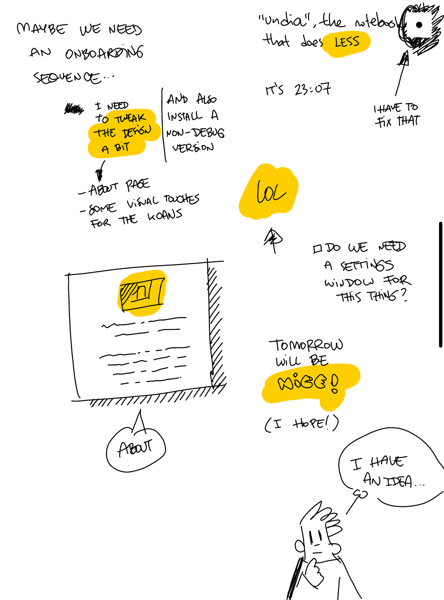
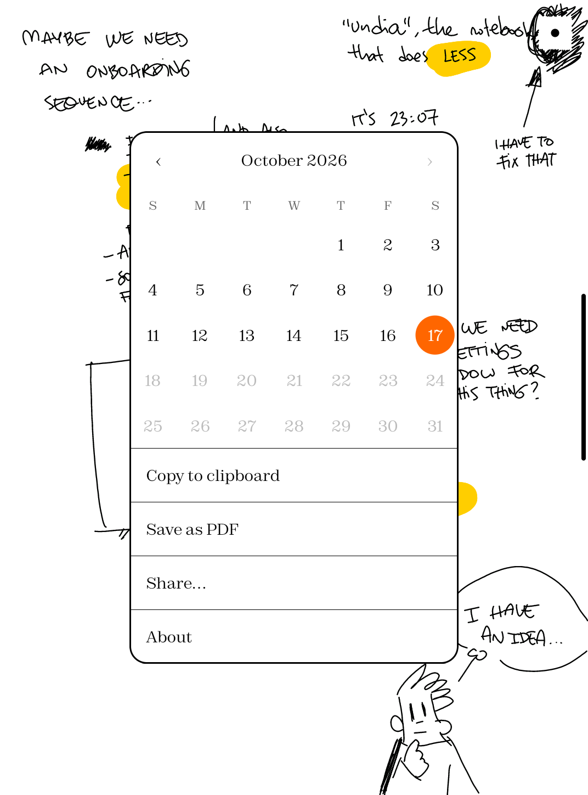
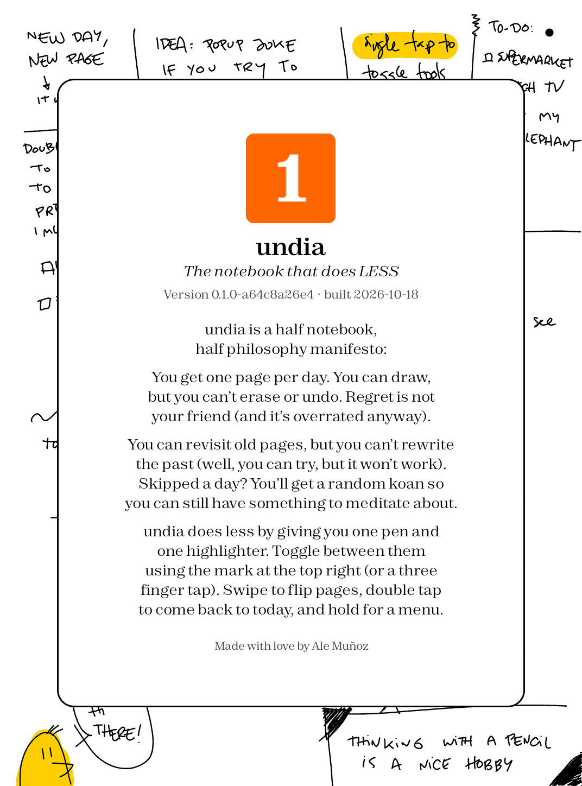
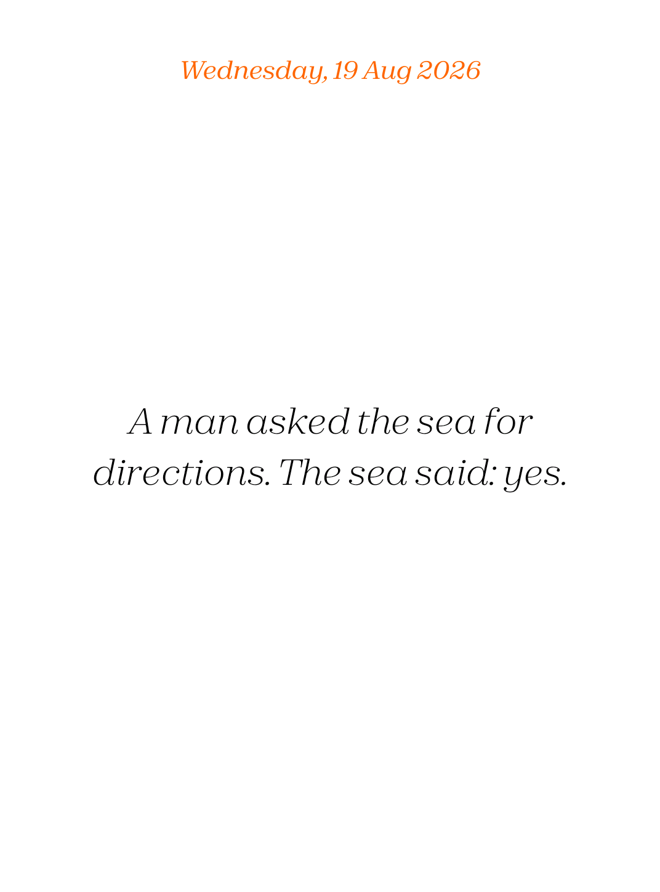

# undia

A one-page-a-day notebook for Android tablets, at its best on e-ink tablets like Boox.

You get **one page per day**. It opens on a blank page with a fixed 0.2 mm pen, and what you draw on it stays there. There is no eraser, no clear and no undo: a day's page can only be added to, never taken back.

> [!NOTE]
> **How this project was made.** An LLM wrote 99.9% of the code. I made all product design decisions, including spending an absurd amount of time on UI and UX polish. What undia is and isn't, how it looks, and how it feels to use, is 100% human made. Code was just a means to get us there.

## Screenshots

| Today | Hold for the menu | About | A past day |
| --- | --- | --- | --- |
|  |  |  |  |

Taken on a Go 6 Gen 2. The panel is black and white, so the orange date and the yellow highlighter show up as grays on the device itself.

## How it works

- **One page per day.** Today's page is the only one you can draw on.
- **Notes renew at 00:00 local time.** When the date changes, a new blank page starts. If you are looking at the page of the day that just ended when midnight passes, the app moves you to the new one.
- **Old days are read-only.** You can go back to any day in the past to revisit your notes, but you can't edit them. You can still scribble on them, but that ink is gray and dotted to show it is temporary: it is never saved and disappears when you leave the page. It also fades: it gets lighter every second and is gone after six seconds.
- **Empty days give you a koan.** Going back to a day where you did not draw anything shows a koan instead of a blank page. The same day always shows the same koan.
- **Nothing is erased.** There is no way to erase or clear a page, in the app or by gesture.

## Using it

| Do this | To get this |
| --- | --- |
| Draw with the pen | 0.2 mm black line |
| Tap with one finger (or three) | Switch between pen and highlighter. The mark at the top right shows which one is on: a small black dot for the pen, a larger colored circle for the highlighter. It's only an indicator, so you can draw right under it |
| Swipe left or right with one finger | Next or previous day (never past today) |
| Double-tap with one finger (on a past day) | Go back to today. On today's page every tap switches the tool, so a double tap switches it twice |
| Hold one finger on the screen | Open the menu |

The highlighter is a 4 mm #ffcc00 stroke (a light gray on the black-and-white panel) that keeps your ink readable underneath. It goes back to the pen by itself 0.8 s after a highlight stroke, so you can highlight several things in quick succession.

The menu has a **calendar** to jump to any day up to today (past days open read-only), and:

- Copy to clipboard (the page as a PNG)
- Save as PDF (to Downloads)
- Share… (Android share sheet, for example LocalSend)
- About (how the app works, its version and build date)
- Back to today (when you are on a past day)

A past day with nothing on it shows its date, centered at the top in the same font as the koans (Zodiak Italic), above the koan. A past day with notes shows no date, because it would be drawn over them, and neither does today's page.

## Debug builds

Debug builds (the ones from Android Studio or `./gradlew assembleDebug`) have one extra: holding the pen's side button and drawing over strokes erases them, so test pages can be cleaned up. Release builds can't erase anything.

## Devices

Built and tested on a Boox Go 6 Gen 2 running firmware 4.2.2 (Android 13). That is the only device and firmware it has been tried on. Nothing is tied to its resolution: the pen is 0.2 mm wide and the highlighter 4 mm on any panel, because the sizes come from the real pixel density the device reports, and the layout uses dp and fractions of the screen. Other Boox tablets with a stylus, like the Go 10.3, should work, but only the Go 6 has been tried.

On a Boox the stylus draws and fingers only make gestures. On any other Android tablet (Android 8 or newer) the app does not use the Onyx pen libraries: the stylus draws, and until it sees a stylus a finger draws too, taking the stroke back if it turns out to be a page-turning swipe. That path has been tried on a Huawei tablet running Android 8.0, with a finger only.

## Installing

The plan is to publish undia on Google Play; it isn't there yet. Until then, and for anyone who prefers not to use it, every release is a signed APK: download it from the [latest release](https://github.com/bomberstudios/undia/releases/latest) in your tablet's own browser, open it from the downloads, and tap Install. The first time, Android may ask you to allow installs from that browser. There is no need to use `adb`.

## Building

Open the project in Android Studio, or from the command line:

```bash
./gradlew assembleDebug
adb install -r app/build/outputs/apk/debug/app-debug.apk
```

### Releases

Every push to `main` that changes more than documentation (`*.md`, `docs/`, `LICENSE`) runs `.github/workflows/release.yml`, which builds a signed release APK and publishes it as a GitHub release named like `v0.1.1-a638359bcf`: the number comes from the `VERSION` file at the root of the repo, followed by the first 10 characters of the commit hash. To change the version, edit `VERSION` in a commit (it must look like `1.2.3`). Pull requests only get a debug build (`build.yml`), so the usual flow is to work on a branch, open a PR and merge it.

The signing key is stored in the repository secrets `KEYSTORE_BASE64`, `KEYSTORE_PASSWORD`, `KEY_ALIAS` and `KEY_PASSWORD`. A copy of the key and its password is in `~/.config/undia/` on the machine that created it; keep a backup, because an app can only be updated by APKs signed with the same key. A local release build uses the same key when `STORE_FILE`, `STORE_PASSWORD`, `KEY_ALIAS` and `KEY_PASSWORD` are set in the environment, and falls back to the debug key otherwise.

The Onyx pen libraries are downloaded from Onyx's Maven repository (`http://repo.boox.com/repository/maven-public/`), so the build needs network access to it. Onyx's own examples of how to use them are in [OnyxAndroidDemo](https://github.com/onyx-intl/OnyxAndroidDemo).

## Where things are

Pages are stored as one plain SVG file per day (`yyyy-MM-dd.svg`, one polyline per stroke) in the app's private storage, so they open in any browser or vector editor. Code is in `app/src/main/java/org/naranjanaranja/undia`:

- `UndiaView.kt`: the canvas, the Onyx pen input, the daily pages and saving
- `MainActivity.kt`: the menu, the calendar and the midnight rollover
- `Exporter.kt`: clipboard, PDF and share
- `PageFile.kt`: reading and writing the SVG pages
- `Koans.kt`: the koans for empty days
- `app/src/test`: unit tests for the koans and the page files (`./gradlew testDebugUnitTest`, run on every pull request)
- `fonts/`: the Zodiak font files (copied, renamed, into `res/font/` for the app, which uses Zodiak for all text; the date and koans are in Zodiak Italic)
- `design/undia.svg`: the app icon source; the Android version is `res/drawable/ic_launcher_foreground.xml` on an orange background

## Thanks

- **Onyx.** The pen and the e-ink screen are driven by Onyx's SDK, and their [OnyxAndroidDemo](https://github.com/onyx-intl/OnyxAndroidDemo) repository of API demos is the best documentation for it.
- **Zodiak.** All the text, in the app and on the site, is set in Zodiak by Indian Type Foundry, a free font from [Fontshare](https://www.fontshare.com/fonts/zodiak) under the ITF Free Font License.
- **booxday.** Thanks to fortolano, who made [booxday](https://github.com/fortolano/booxday), for the inspiration to go and build my own Boox app.

## License

The code is under the [MIT License](LICENSE). The Zodiak font files (`fonts/`, `app/src/main/res/font/`, `docs/assets/`) are not: they stay under the ITF Free Font License.
